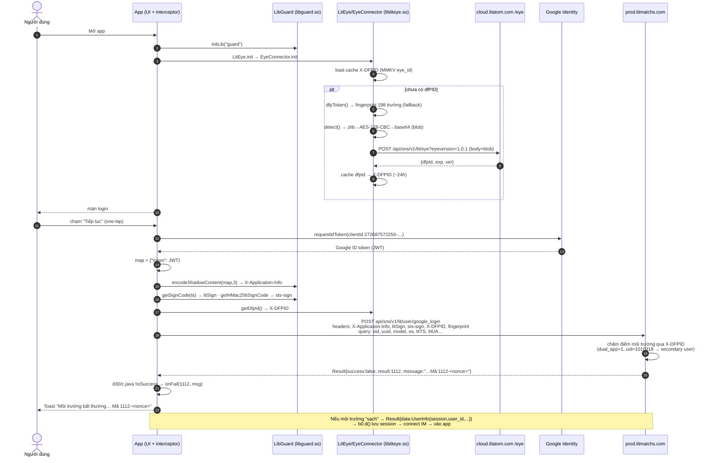

# 09 — Luồng đăng nhập đầy đủ (mở app → Google login) + cơ chế lỗi 1112

> Ghi chú lịch sử về workflow đăng nhập Google. Những nhận định về 1112, DFP
> và server bên dưới có giới hạn; xem hai request và response kiểm chứng mới
> tại [13](13-google-login-hai-truong-hop.md). Tham chiếu: ký request
> [06](06-api-va-ky-request.md)/[07](07-libguard-getsigncode.md), Eye
> [08](08-liteye-native-returns.md), dữ liệu thiết bị [10](10-thong-tin-thiet-bi.md).

## 0. Sơ đồ tổng quát
```
Mở app
 ├─ LibGuard.initLib("guard")            (libguard.so: ký request)
 ├─ LitEye.init → EyeConnector.init      (libliteye.so: anti-fraud)
 │    ├─ load cache X-DFPID (MMKV construct_liteye_id / "eye_id")
 │    ├─ dfpToken()  → fingerprint thiết bị 198 trường (nếu chưa có dfPID)
 │    └─ fetchEyeToken(): detect() → POST /api/sns/v1/lit/eye → {dfpId,exp,ver} → X-DFPID
 └─ Màn login
      └─ Google one-tap (GoogleLoginActivity) → ID token (JWT)
           └─ {"token": JWT} → va0.a.m() → POST api/sns/v1/lit/user/google_login
                 ├─ a00/l.java:  + query sid/uuid/model/os... + header "fingerprint"=AES({"uuid":..})
                 ├─ EyeInterceptor: + X-DFPID, + X-SIUA (tùy cấu hình)
                 ├─ c00/a.java:  + litSign, ts, litTime, X-request-Id, sts-sign, X-Application-Info=encShadow(query,3)
                 └─ EyeQueryInterceptor: + litTS/litUA/litNO/litVS/litCK
      → Server chấm điểm môi trường qua X-DFPID
      → Result{success=false, result=1112, message:"…Mã 1112-<nonce>"}  (secondary-user)
      → client toast nguyên văn (ll.i.S(msg)) — KHÔNG có gate client
```

## 0.1. Sequence diagram


---

## 1. Giai đoạn MỞ APP (khởi tạo bảo mật)

### 1.1. Hai native lib khởi tạo
- `com.litatom.libguard.LibGuard.b()` → `initLib(ctx)` (load `libguard.so` tên "guard"): sẵn sàng ký `litSign`/`sts-sign`/`X-Application-Info`.
- `com.lit.liteye.LitEye.init(ctx)` → `EyeConnector.init(EyeContext)` (`com/construct/liteye/EyeConnector.java`): khởi tạo anti-fraud.

### 1.2. Đăng ký "eye" → lấy X-DFPID (xem [08](08-liteye-native-returns.md) §6)
1. `EyeConnector.init`: đọc cache MMKV `construct_liteye_id` key `eye_id` = `EyeDfpId{dfpId,ver,exp}`; nếu còn hạn (`now < exp`) dùng luôn.
2. `fetchLocalToken()`: nếu chưa có dfPID → `LitEye.dfpToken()` (fingerprint 198 trường, xem [10](10-thong-tin-thiet-bi.md)) làm fallback tạm.
3. `fetchEyeToken()` (thread nền): `LitEye.detect()` → blob `base64(AES-128-CBC(zlib(payload)))`, payload = `2.1}}1.9.9|<ts>|<uuid>}}<11 cờ anti-tamper>}}`.
4. `EyeRequest.call(blob)`:
   ```
   POST https://cloud.litatom.com/api/sns/v1/lit/eye?eyeversion=1.0.1
   Content-Type: application/json; charset=UTF-8
   <body = blob detect(), raw string>         + query sid/uuid/... (ParamsInterceptor) + cpu_abi
   ```
5. Response (thật, lấy từ cache):
   ```json
   {"dfpId":"4TdafYa7HKc7Qaao+gwWmH5YHZTrVFrAbanRgg1XwaN0BrpRdsYAb9+BQglAH7ENDKYv+/H7j9DCbO147//oug==","exp":1794578908591,"ver":"0.0.2"}
   ```
   → `dfpId` thành header **`X-DFPID`** cho MỌI request; hạn ~24h.

---

## 2. Giai đoạn ĐĂNG NHẬP GOOGLE

### 2.1. Lấy ID token (`com/lit/app/ui/login/GoogleLoginActivity.java`)
- `onCreate`: `GoogleSignInClient` với `requestIdToken("272687572250-i5659eubkl38ck9n17mrijl0neh7rgkc.apps.googleusercontent.com")`. Hai chế độ (cờ remote `googleLoginMode`):
  - classic `getSignInIntent()` (reqCode **100**)
  - Identity one-tap `GetSignInIntentRequest` (reqCode **101**) ← màn một chạm đã thấy.
- `onActivityResult`:
  - 100 → `GoogleSignIn.getSignedInAccountFromIntent(..).getIdToken()`
  - 101 → `Identity.getSignInClient(this).getSignInCredentialFromIntent(..).getGoogleIdToken()`
  - cả hai → `h(token)`.
- `h(String token)`: `map.put("token", token)` → `va0.a.m(map)`. (bản quản lý trùng: `com/lit/app/ui/login/i0.java`.)

### 2.2. Request login (ví dụ Google)
```
POST  https://<domain>/api/sns/v1/lit/user/google_login          (TransferDomain, không hard-code)
Body (trước khi mã hoá):  {"token":"<Google ID token = JWT>"}
```
Body JSON này **không gửi plaintext** trong cấu hình quan sát: converter
`bg0/b.java` mã hóa JSON bằng `encodeShadowContent(x,3)` và tạo body với
`Content-Type: application/x-litatom-json; charset=UTF-8`. Interceptor
`c00/a.java` mã hóa **query** riêng cho header `X-Application-Info`. Chi tiết
hai response thực tế: [13 — Google login: môi trường và khóa tài khoản](13-google-login-hai-truong-hop.md).

Ba endpoint third-party (đều `@Body Map`, field luôn tên `"token"`):

| Provider | Class lấy token | "token" chứa | va0.a | Endpoint |
|---|---|---|---|---|
| Google | GoogleLoginActivity.h / i0.java | ID token (JWT) | `m` | `api/sns/v1/lit/user/google_login` |
| Facebook | FacebookLoginActivity.i (`AccessToken.g`) | FB access token | `q` | `api/sns/v1/lit/user/facebook_login` |
| TikTok | TikTokEntryActivity.onResp/h | **authCode** (OAuth code) | `a` | `api/sns/v1/lit/user/tiktok_login` |

Login bằng OTP (không mật khẩu): `phone_login` `{phone,zone,code}` (`t`), `email_login` `{email,code}` (`A`); mã OTP xin qua `get_sms_code {phone,zone,source}` (`e`). **Không có endpoint register riêng** (login xong → `user/info` để hoàn tất hồ sơ nếu `is_first_login`).

---

## 3. Chuỗi interceptor — các header/param gắn vào MỌI request

| Nguồn | Thêm gì |
|---|---|
| `a00/l.java` (common) | **query**: `sid`(=session), `uuid`, `version`, `lang`, `platform=android`, `model`, `loctype`, `os`(SDK_INT), `net_type`, `appid`, `app_source`, `han`. **header**: `lit-user-id`, `v-mode`(cờ VPN). **Riêng endpoint auth** (`get_sms_code`,`phone/google/facebook_login`,`user/info` + `guardUrls`): header **`fingerprint`** = AES(`{"uuid":…}`, key `CB7F786FC0E6E105E6DA03D1FFF05C0F` = mode‑1 của libguard) |
| `EyeInterceptor` | header `X-DFPID` (= getDfpId), `X-SIUA` (= fetchSIUA khi được bật); hai lượt ngày 13/11 có cả hai header |
| `c00/a.java` | header `ts`, `litTime`, `litSign`=`getSignCode(ctx,litTime)`, `X-request-Id`(UUID), `sts-sign`=`getHMac256SignCode(ts_uuid)`, **`X-Application-Info`**=`encodeShadowContent(query,3)` |
| `EyeQueryInterceptor`/`EyeSecureQuery` | Có thể thêm query `litTS`, `litUA`, `litNO`, `litVS`, `litCK` theo cấu hình; hai lượt Google login trong tài liệu 13 không quan sát các tên này ở điểm gửi. |

> Chi tiết thuật toán từng chữ ký: [06](06-api-va-ky-request.md)/[07](07-libguard-getsigncode.md). `sid` đi ở **query** (không phải header); session lưu **plaintext** MMKV `litmatch_key_info` (`KeyInfo{session,hxPwd,userId}`).

---

## 4. Response login

Envelope `com/litmatch/network/Result` (`.lit.app.net.Result`):
`{success:bool, result:int(mã), msg, message, data<T>, diamonds, changed, activity, hash_code, other_info}`. `@c` trên 5 endpoint login = **giữ nguyên raw body** để parse lại khi fail (không phải mã hoá).

`data` = `com/lit/app/bean/response/UserInfo` — trường quan trọng:
- **`session`** = session token (sid) → `b0.d()` lưu, rồi blank khỏi UserInfo.
- **`user_id`**, **`is_first_login`** (user mới), **`is_banned`**/`blocked`/`is_been_blocked`/`removed` (cờ ban/khoá).
- `huanxin{user_id,password}` = creds IM EaseMob (dùng ngay sau login để connect chat).
- `need_bind_phone`, `finished_info`, `lit_id`, `nickname`, `vip_info`…

**Thành công** → `b0.d(UserInfo)` lưu session → connect IM (`a2.e().g(huanxin...)`) → vào app.
**Mã fail** đã quan sát: `-210` (cần xác thực/multi-account), `-200` (tài khoản deactivate), `-14`, và **`1112`** (môi trường bất thường).

---

## 5. Ghi chú lịch sử về lỗi 1112

> **Cập nhật 13/11/2026:** Phần dưới là nhận định trước đây, chưa được chứng
> minh về nguyên nhân server quyết định hay tình trạng device ban. Lượt mới
> thay đồng thời bốn giá trị và làm mới DFP nhận kết quả API thành công;
> đăng nhập lại không hook hiện thông báo khóa tài khoản. Xem bằng chứng và
> giới hạn tại [tài liệu 12](12-kiem-chung-login-user-10.md).
> Lượt quan sát mới báo môi trường trả `result=-1`, trong khi `1113-...`
> nằm trong message. Không suy ra các chuỗi mã trong message là `result`.

**1112 là verdict của SERVER, không phải check client.**
1. Ghi chú cũ về `1112` chưa có response gốc để xác nhận `result` hay ý nghĩa
   phần sau mã. Không đủ bằng chứng khẳng định `result=1112` hay nonce là
   request ID. Response và message quan sát mới xem [13](13-google-login-hai-truong-hop.md).
2. Server quyết định dựa trên **`X-DFPID`** (fingerprint thiết bị, [10](10-thong-tin-thiet-bi.md)). Trên máy này (user 10) fingerprint lộ môi trường **secondary‑user/cloned** không thể giấu:
   - `dual_app="1"`, `uid="1010318"` (→ userId 10), `cgroup=".../uid_1010318/pid_…"`, `installed_from_google="0"`.
   - (Root/frida/hook đã bị APatch giấu = `0`/`none`, nhưng signal secondary‑user thì không giấu được.)
3. Cộng với việc **user 0 đang bị device‑ban**, server coi môi trường bất thường → 1112.

> Chốt: lỗi đến từ **chính sách chống gian lận phía server** đọc fingerprint thiết bị, không phải client tự chặn. Đây là tài liệu để **hiểu** cơ chế; không bao gồm cách né.

---

## 6. Phụ lục — các file khoá
- `va0/a.java` (iface login), `com/lit/app/ui/login/GoogleLoginActivity.java` / `i0.java` (Google), `FacebookLoginActivity.java`, `com/litatom/app/tiktokapi/TikTokEntryActivity.java`.
- `c00/a.java` (ký litSign/sts-sign/X-Application-Info), `a00/l.java` (common params + fingerprint header), `com/construct/liteye/EyeInterceptor.java`/`EyeConnector.java`/`EyeRequest.java`.
- `com/lit/app/model/b0.java` + `KeyInfo.java` (session), `com/litmatch/network/Result.java` + `d30/c.java` + `b.java` (envelope + onFail), `ll/i.java:545` (toast).
- `com/lit/app/bean/response/UserInfo.java` (data login).
