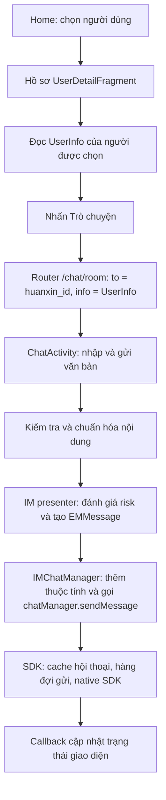

# Hồ sơ và luồng nhắn tin một người

Kết quả điều tra tiếp và hướng dẫn client Node.js hiện tại nằm ở [tài liệu kết nối Hyphenate](22-nodejs-hyphenate-connect.md). Phạm vi và giới hạn bên dưới mô tả lượt khảo sát ban đầu.

Phạm vi: Litmatch 7.77.0 (`com.litatom.app`) trên Android user 10. Phần thao tác thực tế được đánh dấu riêng; các chi tiết kỹ thuật còn lại được đối chiếu từ mã Java sau decompile, chưa ghi lại gói mạng thực của lần gửi.

## Một lần thực hiện trên thiết bị

1. Từ Home chọn hồ sơ tên hiển thị **châu**; giao diện hiển thị Lit ID `7841405553`.
2. Nhấn **Trò chuyện**, nhập `Chao ban nha` và nhấn **Gửi** một lần. Màn chat hiển thị nội dung lúc **08:50** theo đồng hồ thiết bị.
3. Màn hình hiển thị biểu tượng giống tài nguyên `message_delivered`. Trong [MsgAdapter.java](../base-decompiled/sources/com/lit/app/ui/chat/adapter/MsgAdapter.java), biểu tượng này được chọn khi `EMMessage.status() == SUCCESS` và `isAcked()` là false. Vì vậy quan sát phù hợp với trạng thái gửi thành công theo SDK, chưa có xác nhận đã đọc tại thời điểm chụp. Tên tài nguyên không đủ để chứng minh thiết bị người nhận đã nhận được tin.

Đây là một tin nhắn thật được gửi theo yêu cầu; không có bằng chứng về phản hồi của người nhận. Lit ID hiển thị ở hồ sơ không được giả định là `user_id` nội bộ hay `huanxin_id`.

## Luồng từ Home đến phòng chat

- [UserDetailFragment.java](../base-decompiled/sources/com/lit/app/ui/me/userdetail/UserDetailFragment.java) chuyển sang `/chat/room`, truyền `to` từ `UserInfo.getHuanxin_id()`, `info` là `UserInfo` và `ENTER_TYPE` là `homepage_detail`. Một nhánh **Say Hi** có thể lấy mẫu chào và có xử lý bổ sung; không mặc định mọi hồ sơ đi cùng một nhánh.
- API hồ sơ được khai báo trong [lz/c.java](../base-decompiled/sources/lz/c.java): `GET api/sns/v1/lit/user/get_info/{userId}` với các query như `from`, `is_zone`, `is_mini_profile` và `source` tùy overload. Response được khai báo là `Result<UserInfo>`. Đây là bằng chứng tĩnh về endpoint, không phải request đã bắt được trong lần thử.
- `UserInfo` có những trường như `user_id`, `huanxin_id`, nickname, avatar, bio và age; tên hiển thị, Lit ID, ID nội bộ và ID dùng cho IM cần được giữ phân biệt. Xem [UserInfo.java](../base-decompiled/sources/com/lit/app/bean/response/UserInfo.java).
- [uy/a.java](../base-decompiled/sources/uy/a.java) còn khai báo `GET api/sns/v1/lit/user/full_info_by_huanxin_id?target_huanxin_id=...` và `POST api/sns/v1/lit/user/info_by_huanxin` để làm việc với thông tin người dùng theo ID IM. Chưa xác nhận endpoint nào đã chạy ở lần thử.

## Workflow gửi văn bản

1. [ChatActivity.sendText](../base-decompiled/sources/com/lit/app/ui/chat/ChatActivity.java) gọi bước kiểm tra nội dung, cắt khoảng trắng đầu/cuối rồi chuyển văn bản và `UserInfo` cho presenter.
2. [im/o.java](../base-decompiled/sources/com/lit/app/im/o.java), hàm `q`, kiểm tra điều kiện gửi; gọi `f1.c` để xử lý risk, nhận nội dung cùng mã risk và dừng nếu nội dung sau xử lý rỗng. Nó tạo tin bằng `f1.k`, thêm thuộc tính `accost` tùy lịch sử đối thoại, các thuộc tính tùy chọn và callback trạng thái.
3. [im/sdk/f1.java](../base-decompiled/sources/com/lit/app/im/sdk/f1.java) tạo `EMMessage.createTextSendMessage(content, to)`; đặt `attr_risk`, có thể thêm `attr_clear_text` tùy trường hợp. Nếu phù hợp, ứng dụng gắn `em_apns_ext` chứa thông tin hiển thị push. Hàm `w` còn có thể gọi `POST api/sns/v1/lit/user/accost_count` với `targetId` khi cần, thêm `risk_msg_count`, `mark_msg_id` và một số thuộc tính người gửi trước khi gọi `EMClient.chatManager().sendMessage(message)`.
4. [EMChatManager.java](../base-decompiled/sources/com/hyphenate/chat/EMChatManager.java) đưa tin vào cache hội thoại, đưa việc gửi vào hàng đợi và gọi `emaObject.sendMessage`. Callback được dùng để cập nhật giao diện thành công hay lỗi. Kết quả gửi và xác nhận đọc là hai trạng thái khác nhau.
5. Ở giao diện, [MsgAdapter.java](../base-decompiled/sources/com/lit/app/ui/chat/adapter/MsgAdapter.java) hiển thị tiến trình cho `CREATE`/`INPROGRESS`, lỗi cho `FAIL`, và với `SUCCESS` chọn biểu tượng theo `isAcked()` trong nhánh chat thông thường.

## Các giới hạn và điểm cần nghiên cứu tiếp

- Quan sát giao diện và đối chiếu mã hỗ trợ kết luận về trạng thái do ứng dụng hiển thị; chưa quan sát callback trực tiếp, phản hồi mạng, nội dung gói, hay thiết bị người nhận.
- Lớp Java dùng API Hyphenate/Easemob `EMClient` và `EMMessage`. Dự án có endpoint và cấu hình OpenIM, nhưng lần gửi này chưa xác minh lớp vận chuyển thực tế hoặc đường đi WebSocket; không coi tên host OpenIM là đích đã quan sát của tin nhắn.
- Các API hồ sơ, đếm bắt chuyện và push có thể khác nhau theo loại tài khoản, khu vực, feature flag và lịch sử hội thoại. Chưa đủ bằng chứng để tái tạo toàn bộ request hoặc khẳng định mọi điều kiện kiểm duyệt.
