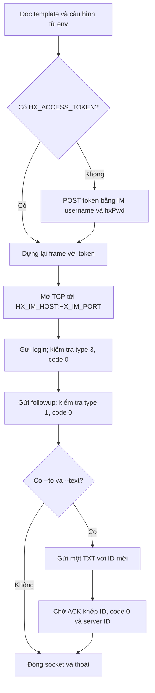

# Kết nối Hyphenate bằng Node.js

**Node tự tạo template, không cần capture:** chạy [hyphenate-bootstrap.js](../scripts/hyphenate-bootstrap.js). [Hướng dẫn bootstrap](28-node-hyphenate-bootstrap.md) mô tả đầu vào app key/username/password, API lấy host/port và mẫu login v6 đã kiểm chứng. Các mô tả mẫu Android v3 bên dưới vẫn áp dụng cho template capture cũ.

Cập nhật ngày 14/11/2026, cho bản một file [scripts/hyphenate-connect.js](../scripts/hyphenate-connect.js). Tài liệu mô tả đúng cấu hình và lệnh của bản hiện tại, không yêu cầu các script hook đã chuyển ra `/tmp`.

**Kết quả hook bổ sung:** [toàn luồng gửi TXT, HTTPS đi kèm và lịch sử server](23-full-workflow-gui-tin.md). Tin Node lúc 10:19 đã được tìm thấy trong history server bằng SDK với `setIsSave(false)`, nhưng không có trong cache trên điện thoại. Nội dung gửi qua TCP; app còn cập nhật metadata qua HTTPS. Chưa xác nhận delivery/read.

## 1. Script làm gì?

Script đọc cấu hình từ environment, lấy token Hyphenate nếu cần, mở TCP, trao đổi handshake và một gói tiếp theo. Mặc định nó đóng kết nối ngay sau đó. Nếu truyền rõ `--to` và `--text`, nó gửi **một tin văn bản thử**, chờ phản hồi khớp ID rồi đóng kết nối; không tự gửi lại. Thư viện `protobufjs` xử lý các field protobuf; `node:net` xử lý TCP; `fetch` gọi API token. Phiên bản dependency nằm trong [package.json](../scripts/package.json) và [package-lock.json](../scripts/package-lock.json).

Tùy chọn `--litmatch` bổ sung HTTPS metadata sau khi TCP được server chấp nhận; `--sync-only` chỉ gọi metadata, không đăng nhập IM hay gửi tin. Phần HTTP dùng lại [common.js](../scripts/common.js), không thêm một client IM riêng. Chi tiết và kết quả test thật ở mục 7.

Trong các lần điều tra trước, tin văn bản từ màn chat Litmatch đi qua `EMChatManager` → `libhyphenate.so` → TCP Hyphenate. OpenIM có kết nối riêng, nhưng không thấy lệnh gửi chat OpenIM trong những lần thử đó. Bản này hỗ trợ gửi TXT thử qua Hyphenate, chưa nhận chat, giữ phiên lâu dài hay tự reconnect. Đây không phải client Litmatch đầy đủ.

Chạy script không cần điện thoại, ADB, Frida, Python hay pcap khi `.env` đã đủ thông tin. CLI connect đọc template từ env; template có thể là mẫu capture Android v3 hoặc mẫu Node v6 tự tạo bằng bootstrap, đều phải khớp tài khoản.

## 2. Thông tin cần trong `.env`

File đang dùng là `scripts/.env`, được Git bỏ qua. Giữ nguyên các biến `LIT_*` có sẵn. Xem tên biến mẫu tại [scripts/.env.example](../scripts/.env.example); các dòng `HX_*` trong file mẫu đang được comment và không chứa credential dùng được.

| Biến | Bắt buộc? | Ý nghĩa và nguồn |
| --- | --- | --- |
| `HX_LOGIN_TEMPLATE_B64` | Có | Base64 của **payload protobuf đăng nhập**, không có prefix độ dài 4 byte. Dùng mẫu capture cùng tài khoản hoặc mẫu Node mới do bootstrap tạo; token trong mẫu rỗng. |
| `HX_IM_HOST` | Có | Host/IP IM đã quan sát. Cấu hình hiện tại dùng `128.1.26.67`; một phiên trước dùng `8.219.196.25`. Không đảm bảo IP cố định. |
| `HX_IM_PORT` | Không | Port TCP, mặc định `6717`. |
| `HX_USERNAME` | Không | IM ID dạng `love…`. Nếu không đặt, lấy từ template; nếu đặt, bắt buộc khớp template. Không phải Lit ID hiển thị, email hay business user ID. |
| `HX_PASSWORD` | Một trong hai | Mật khẩu IM `hxPwd`, dùng để lấy access token. Không phải mật khẩu Google. |
| `HX_ACCESS_TOKEN` | Một trong hai | Token **Hyphenate** còn hiệu lực cho cùng tài khoản. Nếu có giá trị, script dùng token này và bỏ qua bước lấy token bằng password. |
| `HX_REST_BASE` | Không | Mặc định `https://a1-sgp-ga.easemob.com`; code yêu cầu HTTPS cổng 443, host thuộc `easemob.com` hoặc `easecdn.com`. |

App key được đọc từ template, hiện là `1102190223222824#lit`; không có biến `HX_APP_KEY` trong bản này. Token OpenIM và session Litmatch `sid` không thay thế token Hyphenate.

### Nguồn của tài khoản và mật khẩu đã điền

MMKV `default`, key `litmatch_key_info`, có `hxPwd` và business `userId`, không có trực tiếp IM username. Khi điền `.env`, đã đối chiếu `userId` và `hxPwd` với bản ghi SDK trước đó, rồi xác nhận IM username khớp template. Không dùng business `userId` làm IM username.

### Template vẫn chứa những gì?

Mẫu Android capture còn giữ `vid`, `cid`, phiên bản SDK, model, package, các UUID và field phiên chưa giải nghĩa đầy đủ. Mẫu Node v6 mới dùng UUID client/timestamp tự tạo, không cần `vid/cid` Android. Base64 là cách lưu bytes; payload phải đúng schema protobuf. Đổi tài khoản có thể chạy lại bootstrap với credential tương ứng.

Token đăng nhập được chèn vào field `9.18.token` lúc chạy; mẫu có `9.17 = v6.0` dùng tiền tố `$t$` theo SDK Web, mẫu v3 cũ giữ định dạng cũ. Mật khẩu và token không được in ra log của script. Nếu muốn dùng `HX_PASSWORD`, bỏ giá trị `HX_ACCESS_TOKEN` cũ khỏi cấu hình/environment để tránh ưu tiên nhầm token.

## 3. Cách chạy

Các lệnh sau chạy từ thư mục gốc project. Môi trường đã dùng là Node.js `22.23.4`; dùng Node.js 22+ cho workflow này.

Nếu chưa cài dependency:

```sh
npm --prefix scripts ci --ignore-scripts
```

Xem trợ giúp và kiểm tra cấu hình cơ bản:

```sh
node scripts/hyphenate-connect.js --help
node --env-file=scripts/.env scripts/hyphenate-connect.js --dry-run
```

`--dry-run` đọc template, xác định tài khoản/host và nguồn credential; không gọi API hay mở TCP. `authSource` nên là `username_password` hoặc `supplied_token`. Nếu là `missing`, chưa cung cấp mật khẩu/token. Dry-run thành công không chứng minh credential còn hiệu lực hay toàn bộ handshake hợp lệ.

Kết nối thực:

```sh
node --env-file=scripts/.env scripts/hyphenate-connect.js
```

Phần IM không tự tìm/nạp `.env`; tùy chọn `--env-file` của Node thực hiện việc đó. Riêng helper metadata có thể đọc `LIT_*` từ `scripts/.env`, ưu tiên giá trị trong environment. Lệnh npm `im:connect` chỉ gọi JS, nên chỉ dùng trực tiếp khi các biến `HX_*` đã được đưa vào environment. Không ghi đè `.env` hiện tại bằng file mẫu.

CLI hỗ trợ `--help`/`-h`, `--dry-run`, `--to`, `--text`, `--litmatch`, `--sync-only`, `--first-contact`. Các tùy chọn cũ `--capture`, `--snapshot`, `--token-file` không còn được hỗ trợ; thông tin kết nối nằm trong environment.

### Gửi một tin thử

Cần credential/template đăng nhập hợp lệ như trên, **IM ID `huanxin_id` của người nhận**, và nội dung. Có thể lấy ID từ `data.user_infos` của API Home; không dùng nickname, Lit ID hiển thị hoặc business `user_id` thay thế.

Kiểm tra trước, không gửi:

```sh
node --env-file=scripts/.env scripts/hyphenate-connect.js --dry-run --to IM_ID_NGUOI_NHAN --text 'Tin nhắn thử'
```

Sau khi thay placeholder bằng ID đúng, bỏ `--dry-run` để gửi thật. Phải truyền cả `--to` và `--text`; thiếu một trong hai sẽ báo lỗi trước khi kết nối. Không tự động chọn người nhận trong CLI. Mỗi lần chạy chế độ gửi tạo ID mới và có thể gửi thêm một tin thật.

Chế độ thử chỉ tạo TXT một-một và UUID `mark_msg_id`. Nó **không triển khai** kiểm tra nội dung/risk của Litmatch, kiểm tra chặn phía ứng dụng, metadata push hay đồng bộ cache điện thoại; không tự gắn kết quả risk giả định. API hội thoại/accost chỉ chạy nếu bật chế độ ở mục 7. Một lần server chấp nhận TXT không chứng minh tương đương toàn bộ luồng app hoặc mọi người nhận đều nhận/hiển thị được. Không dùng công cụ này để né giới hạn hay gửi hàng loạt.

Giới hạn nội dung cục bộ: không rỗng, không chứa NUL, tối đa 4096 byte UTF-8 (giới hạn của script, chưa xác nhận là giới hạn server). `HX_ACCESS_TOKEN` vẫn được ưu tiên; không cần token OpenIM hoặc quyền quản trị.

## 4. Luồng kết nối và định dạng dữ liệu



### Lấy token

Với app key hiện tại, endpoint là:

```text
POST https://a1-sgp-ga.easemob.com/1102190223222824/lit/token
Content-Type: application/json
Accept: application/json
```

Body gồm `grant_type: "password"`, `username: <IM username>`, `password: <hxPwd>`. Script dùng `access_token` trong response, chỉ log `expires_in`. Token giữ trong bộ nhớ, không ghi thêm file JSON. Request không theo redirect, có timeout 12 giây và giới hạn body response 1 MiB.

REST host trên từng được ghi nhận trong cấu hình khảo sát trước. Ở lượt kiểm
tra sau với tài khoản mới, `files/server.json` liệt kê tên miền `easecdn.com`;
xem phần đối chiếu bên dưới. Không suy ra SDK luôn dùng cùng một hostname.

### Đối chiếu chọn host ngày 14/11/2026

- Hook `EMClient.getOptions()` trong tiến trình Litmatch cho thấy DNS config bật,
  IM server và REST server không được đặt tĩnh qua các getter, IM port bằng 0.
- `files/server.json` hiện liệt kê REST `a1-sgp-ga.easecdn.com` và các điểm
  `msync-im1-sgp.easecdn.com` với IP `161.117.200.216`, `47.88.219.97`,
  cổng 443 và 80. Đây là các lựa chọn trong snapshot, không phải danh sách cố định.
- Với cùng tài khoản, socket ban đầu nối `161.117.200.216:443`. Sau khi đóng
  riêng socket đó để quan sát kết nối lại, hook `connect` ghi nhận lời gọi từ
  `libhyphenate.so` tới `47.88.219.97:80`, sau đó socket ở trạng thái ESTABLISHED.
  Điều này chứng minh cổng có thể đổi ngay trong cùng tài khoản; chưa xác định
  thuật toán chọn hay lý do của SDK cho từng lần.
- Gọi `EMClient.getUserTokenFromServer` trong app và hook DNS ghi nhận
  `a1-sgp-ga.easecdn.com`; callback báo lấy token thành công. Đây là lượt gọi
  chủ động để quan sát, không phải bằng chứng app tự refresh trong nền.
- Hai tài khoản đã lưu đều lấy token thành công khi script gọi
  `https://a1-sgp-ga.easemob.com`. Trên máy khảo sát, hai tên miền REST này
  cùng trỏ tới một chuỗi CNAME/IP tại thời điểm đo; DNS có thể thay đổi. Không
  suy ra mọi request của hai hostname luôn giống nhau hay mọi tài khoản đều
  dùng một host.

### Handshake TCP

Mỗi frame gồm **4 byte độ dài unsigned big endian** rồi payload protobuf. Độ dài không tính 4 byte prefix. Không dùng `encodeDelimited()` của protobuf thay cho prefix này.

Một phiên khác ngày 14/11/2026 kết nối `161.117.200.216:443`, được tìm từ
socket đang hoạt động và mục `msync-im` trong `files/server.json`. Gói đăng
nhập quan sát được dài 457 byte tính cả prefix. Vì host và cổng có thể khác
giữa các phiên, cần xác định kết nối hiện tại trước khi lọc packet; lọc cứng
cổng 6717 có thể bỏ sót. Sau khi tái ghép TCP, đọc prefix 4 byte, kiểm tra
field `8 = 3`, app key và IM username trong `2.1` / `2.2` khớp tài khoản.
Giải JSON ở `9.18`, thay `token` bằng chuỗi rỗng, mã hóa lại protobuf và lưu
**payload không có prefix** thành Base64. `buildLoginFrame` chèn token mới và
thêm prefix khi kết nối. Hai phản hồi trong phiên này có type/code `3/0` và
`1/0`; Node cũng đã kết nối thành công bằng template này, không gửi tin nhắn.
Đây là kết quả thực nghiệm, không phải schema đầy đủ hoặc bảo đảm host cố định.

| Vị trí wire field | Ý nghĩa đã quan sát / cách code dùng |
| --- | --- |
| `2.1`, `2.2` | App key và IM username trong template. |
| `8` của request login | Giá trị `3`. |
| `9.18` | JSON gồm `vid`, `cid`, `token`; chỉ thay token, giữ các giá trị khác. |
| Response login: `8`, `9.8.1` | Code yêu cầu `3`, `0`. |
| Response followup: `8`, `9.1.1` | Code yêu cầu `1`, `0`. |

Gói followup quan sát được là `00000008080040014a005800` (12 byte). Chưa có schema vendor để đặt tên chính thức cho gói này hoặc mọi field/mã trạng thái. Một lần thử token sai nhận mã `2`, còn token hợp lệ nhận `0`; không diễn giải mọi mã `2` trong các trường hợp khác là cùng một lỗi.

`protobufjs.Reader/Writer` giữ thứ tự field, các field chưa biết và độ chính xác số nguyên 64 bit khi dựng lại frame. Client ghép TCP theo prefix độ dài, xử lý cả frame chia nhỏ hoặc nhiều frame trong một lần đọc. Có deadline 8 giây cho toàn bộ bước TCP/handshake, giới hạn mỗi frame response 1 MiB, không retry tự động.

### Gói TXT và phản hồi gửi

Field number dưới đây được đối chiếu với packet SDK cũ và lần gửi Node thật; chưa có schema vendor đầy đủ:

| Field | Ý nghĩa đã đối chiếu |
| --- | --- |
| Request `8=0` | Loại frame dùng trong lần gửi TXT |
| `9.1.1` | ID tạm mới của tin, giữ dạng chuỗi uint64, không chuyển qua JS Number |
| `9.1.3.2` | IM ID đích |
| `9.1.5=1`, `9.1.6.1=1` | Giá trị giữ theo mẫu TXT một-một đã quan sát |
| `9.1.6.2.2`, `9.1.6.3.2` | IM ID người gửi/người nhận |
| `9.1.6.4` | Body: field `1=0`, field `2` là text UTF-8 |
| `9.1.6.5` | Attribute lặp; bản thử chỉ thêm `mark_msg_id` UUID mới |
| Response `8=0`, `9.1.1=0` | Phản hồi với mã thành công đã quan sát |
| Response `9.2`, `9.3` | ID tạm được phản hồi lại và ID server cấp |

Sau khi gửi, script chờ thêm tối đa 8 giây. Chỉ xác nhận khi response có đúng ID tạm, mã `0` và server ID khác 0; frame không khớp không được coi là ACK của tin. Timeout hoặc socket đóng sau khi gửi nhưng chưa có ACK được báo là **kết quả chưa rõ**: tin vẫn có thể đã được server nhận, không tự chạy lại để tránh trùng. Không có retry hay bảo đảm exactly-once giữa nhiều lần chạy.

TCP hiện dùng `node:net`, không TLS ở lớp script; nội dung và credential trong handshake không được bảo vệ bởi TLS trên đường này. Chỉ dùng cho thử nghiệm có kiểm soát, không coi đây là cấu hình production an toàn.

## 5. Đọc log và xử lý lỗi

Luồng log thành công, nếu lấy token bằng password:

```text
token_obtained
tcp_connected
login_response       type="3", code="0", accepted=true
followup_response    type="1", code="0", accepted=true
handshake_complete   chatSent=false
```

Nếu dùng token có sẵn thì không có `token_obtained`. `tcp_connected` mới chỉ chứng minh mở socket; phải xem cả hai response và `handshake_complete`. Thành công kết thúc với exit code 0; lỗi CLI/HTTP/socket/handshake được in ra stderr và trả exit code 1. Khi `connectAndCheck()` trả về, việc kiểm tra đã hoàn thành và socket đang đóng; đây không phải kết nối để tiếp tục gửi chat.

Trong chế độ gửi, sau `followup_response` là `send_attempt`, `send_response` (khớp ID), rồi `send_complete` thay cho `handshake_complete`. `serverAccepted=true` chỉ là server chấp nhận; `deliveryConfirmed=false` nhắc rằng chưa xác nhận thiết bị người nhận nhận/đọc tin. Không suy ra gửi thành công chỉ từ `send_attempt`. CLI không in token/password; dry-run gửi có in nội dung dự kiến.

| Lỗi / hiện tượng | Kiểm tra |
| --- | --- |
| Thiếu `HX_LOGIN_TEMPLATE_B64` hoặc `HX_IM_HOST` | Có chạy với `--env-file=scripts/.env` và đúng thư mục gốc không? |
| `Non-canonical template base64` / thiếu field | Template bị cắt, sai định dạng hoặc không phải payload login đã trích. Không tự thêm prefix TCP vào template. |
| `HX_USERNAME does not match…` | Username không thuộc template; cần cấu hình cùng một tài khoản. |
| `Set HX_PASSWORD or HX_ACCESS_TOKEN` | Chưa nạp credential; xem tên biến và các dòng có đang bị comment không. |
| `Token request failed (HTTP …)` | Kiểm tra IM username/hxPwd và REST host; code không tự retry. Không mặc định lỗi này là tài khoản bị khóa. |
| `Unexpected login response…` | Credential hoặc template có thể không còn phù hợp; đọc type/code đã trả về, chưa tự suy nghĩa mọi mã. |
| `TCP connection failed…`, timeout hoặc đóng sớm | Kiểm tra mạng và peer hiện tại; IP từng thay đổi giữa các phiên. Chưa có discovery/reconnect tự động. |
| App điện thoại mất kết nối | Đã xảy ra sau lượt đăng nhập Node trước đó. Mở lại app và kiểm tra lại trạng thái; chưa chứng minh chính xác chính sách server gây ngắt. |
| `Message not accepted (code=…)` | Đã nhận phản hồi khớp ID nhưng không đạt điều kiện thành công; không tự diễn giải mọi mã lỗi. |
| `send outcome unknown, do not retry blindly` | Đã thử ghi tin vào socket nhưng chưa xác nhận ACK; kiểm tra hội thoại trước khi cân nhắc gửi lại. |

## 6. Bằng chứng kiểm tra và giới hạn

- **Live trước khi gộp file:** bắt kết nối của app tới port 6717; frame login dài 405/406/453 byte tùy kết nối. Node lấy token mới khác token snapshot, nhận phản hồi login và followup mã `0`; một lần đối chứng token sai nhận mã `2`.
- **Refactor và gộp file:** đối chiếu frame tạo ra không đổi từng byte khi dùng cùng token; kiểm tra offline với TCP chia nhỏ gói, followup, mã từ chối, đóng sớm và timeout. Bản một file đã được kiểm tra lại handshake bằng server cục bộ và dry-run sau khi bỏ các helper/pcap.
- **Live bản một file sau cleanup:** ngày 14/11/2026 lấy token mới và nhận `login_response code=0`, `followup_response code=0`, `handshake_complete chatSent=false`.
- **Một tin Node thật lúc 10:19:29 GMT+7 cùng ngày:** chọn một ID từ response Home mới, gửi qua probe riêng trong `/tmp`. Tin có local ID `17946263688492433`, UUID `f320a0df-8f8c-43b7-887c-53d185702e4d`; response type `0`, code `0`, trả lại đúng local ID và server ID `1619467109815818896`. Đây là bằng chứng server chấp nhận, chưa xác nhận nhận/đọc phía đối diện. Nội dung là lời báo đang thử kết nối và xin lỗi nếu làm phiền; chỉ gửi một lần, không retry.
- **Sau tích hợp chế độ gửi vào file JS:** kiểm tra offline với server TCP cục bộ cho thành công, chia nhỏ frame, ACK không khớp ID, mã từ chối, thiếu server ID, đóng sớm, timeout và mặc định không gửi. Decoder đọc đúng ACK thật; builder được đối chiếu các field với packet đã gửi. Chạy CLI tích hợp với server cục bộ cũng xác nhận đúng một lần gửi, `send_complete`, không in token, và từ chối trường hợp thiếu `--to` hoặc `--text`. Không gửi thêm tin thật từ CLI tích hợp chỉ để lặp kiểm tra.
- **Bổ sung bootstrap:** đã có API tự tìm host và logic dựng mẫu login Node v6 từ credential, xem [kết quả kiểm chứng](28-node-hyphenate-bootstrap.md). Chưa có nhận chat bằng Node, xác nhận delivery/read, heartbeat lâu dài, reconnect hay toàn bộ kiểm tra nghiệp vụ của app. Kết quả live không bảo đảm credential/host/template luôn còn hiệu lực.

Phần connect trong project chỉ cần file JS, `.env` và dependency npm. Script Python/hook và dữ liệu thử đã chuyển ra `/tmp/lit-im-archive-JSRCDO`; đây là bản lưu tạm để tham khảo, không phải dependency chạy và không bảo đảm tồn tại lâu dài. Những script Python phục vụ điều tra sau này sẽ tạo trong `/tmp`; tài liệu sử dụng vẫn giữ trong `docs/`.

Probe gửi một lần, log riêng quyền `600` và bộ test offline của lượt mới ở `/tmp/lit-send-test-ygcgPC`; không cần các file tạm này để chạy CLI. Log thô có dữ liệu phiên, không đưa lên Git hay chia sẻ công khai.

## 7. Node.js: TCP kèm HTTPS metadata

### Cấu hình và cách chạy

Ngoài `HX_*`, cần `LIT_SID`, `LIT_UUID`, `LIT_VERSION`, `LIT_PLATFORM` trong `.env`. Hai nhóm credential phải thuộc **cùng tài khoản hiện tại**. Token Hyphenate còn dùng được không chứng minh session Litmatch đúng; GET `account/account_info` thành công cũng không xác nhận IM username (response lần thử chỉ chứa thông tin số dư/quyền lợi).

Gửi một TXT và cập nhật metadata cho hội thoại đã có:

```sh
node --env-file=scripts/.env scripts/hyphenate-connect.js \
  --litmatch --to IM_ID_NGUOI_NHAN --text 'Nội dung'
```

Thêm `--dry-run` để xem payload dự kiến mà không gọi mạng. Cho một lần bắt chuyện **mới**, có thể thêm `--first-contact` để gọi `user/accost_count`; script không suy ra trạng thái hội thoại trên điện thoại và không tự bật cờ này.

Nếu tin đã được TCP chấp nhận nhưng metadata lỗi, chỉ chạy:

```sh
node --env-file=scripts/.env scripts/hyphenate-connect.js \
  --sync-only --to IM_ID_NGUOI_NHAN
```

`--sync-only` không cần credential Hyphenate, không mở TCP, không xin token, không gửi text; cấm kết hợp với `--text`. Mặc định không gọi lại `accost_count` để tránh tăng đếm nhiều lần. Không bảo đảm mọi POST là idempotent; nếu timeout thì kết quả ghi có thể chưa rõ, không tự retry.

### Request và trình tự

- `common.buildPostRequest` chỉ nhận ba endpoint đã quan sát, body đúng schema, chat một-một và `source=other`; chỉ gửi tới HTTPS `www.litatom.com`.
- Body là `encodeShadow(JSON.stringify(payload), 3)`, content type `application/x-litatom-json; charset=UTF-8`. Header ký/request ID/query chung dùng lại code hiện có. Response giải mã theo `X-Is-Enc` và kiểm tra request ID khi có header đó.
- Mỗi HTTP request timeout 12 giây, response tối đa 2 MiB, không redirect/retry. Thành công phải đồng thời HTTP 2xx, `success=true`, `result=0`; HTTP 200 riêng lẻ không đủ.
- Bản Node chọn thứ tự: kiểm tra cấu hình → token/TCP/TXT/ACK → POST metadata tuần tự. Đây là lựa chọn triển khai để tách lỗi và tránh gửi lại, **không phải** mô phỏng chính xác lịch coroutine song song của app.
- Với `--first-contact`: `accost_count` → `conversation` → `conversation/source`. Không có cờ: bỏ bước đầu. Dừng tại metadata lỗi, báo endpoint cụ thể; không lặp lại chat.
- `send_complete` xác nhận riêng TCP. `workflow_complete` xác nhận thêm metadata, nhưng luôn ghi `phoneSyncConfirmed=false`, `deliveryConfirmed=false`. Nếu TCP thành công rồi HTTP lỗi, `workflow_partial` giữ server ID và `retryChat=false`, CLI exit 1. `--sync-only` thành công ghi `metadata_complete`, `chatSent=false`.

### Test thật ngày 14/11/2026 và kiểm tra app

Đã gửi đúng một tin Node tới Mít Phương Linh (`love147707828357186`), nội dung `Minh thu Node TCP va HTTPS, cam on ban.`:

1. TCP trả mã `0`, local ID `17946278817686191`, server ID **`1619473608067779152`**.
2. Lần POST `conversation` đầu trả HTTP 200 nhưng `success=false`, `result=-14`. Kiểm tra runtime sau đó xác nhận `.env` có `LIT_SID` và `LIT_UUID` không khớp app hiện tại, trong khi HX username/password vẫn khớp. Không gán nghĩa chung cho mã `-14` chỉ từ một lần này.
3. Đọc lại MMKV/getter của app user 10, cập nhật riêng `LIT_SID` và `LIT_UUID` trong `.env`, giữ file private/ignored. Chạy **`--sync-only`**, không gửi lại tin: `conversation` và `conversation/source` đều HTTP 200, `success=true`, `result=0`, response request ID khớp.
4. Mở lại app và đúng phòng chat: **vẫn chỉ thấy tin gửi từ app lúc 10:34**, chưa thấy tin Node mới. Không xóa dữ liệu hay chèn tin giả để làm UI xuất hiện.
5. Truy vấn history SDK với `setIsSave(false)` lúc 10:47:54 trả đúng tin mới, đúng server ID và nội dung, status `SUCCESS`; local `getMessage` vẫn null trước/sau. `acked=false`, `delivered=false`. Kết luận: gửi/lưu server và hai HTTPS đã xác minh; **đồng bộ cache/hiển thị trên điện thoại vẫn chưa được triển khai**.

Nhánh `accost_count` được test bằng mock trong lượt triển khai này; không gọi live thêm trên hội thoại đã có. Các test offline còn kiểm tra mã hóa/giải mã, request ID sai, HTTP/business/network lỗi, giới hạn response, GET cũ, ACK chia gói/không khớp, timeout, và CLI thành công/partial/sync-only. CLI sync-only được kiểm tra không cần HX và không mở socket. Test tạm và snapshot ở `/tmp/lit-node-workflow-aA6AO3`, không phải dependency runtime.
