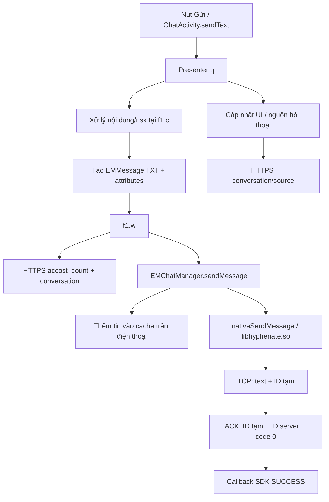

# Hook toàn luồng gửi TXT: TCP, HTTPS và lịch sử trên điện thoại

Kiểm tra ngày 14/11/2026 trên Litmatch 7.77.0, Android user 10, PID `17198`. Phạm vi là **một lần gửi TXT một-một từ giao diện**, không phải mọi chức năng IM của ứng dụng. Hướng dẫn Node ở [tài liệu 22](22-nodejs-hyphenate-connect.md).

## Kết luận

- **Nội dung tin đi qua Hyphenate TCP `128.1.26.67:6717`.** Packet capture hai chiều chứa đúng text, đúng ID tạm, ACK mã `0` và ID server khớp callback SDK.
- **Có thêm HTTPS**, không phải chỉ một request: `user/accost_count`, `user/conversation`, `user/conversation/source`. Trong lần này chúng chứa metadata, không chứa nội dung chat. Còn có GET `home/spam_words_v2`.
- Callback SDK `SUCCESS` được hook trước khi ba POST trả về HTTP 200. Code cho thấy các request trên chạy bất đồng bộ, không chờ response thành công rồi mới gọi SDK gửi tin. Không coi HTTP là phương thức thay thế TCP để gửi text.
- **Tin Node trước đó có trong lịch sử server.** Đọc bằng SDK với `setIsSave(false)` trả đúng nội dung/ID, nhưng `getMessage(nodeId)` trên điện thoại vẫn null trước và sau truy vấn. Tin không hiện ở điện thoại không đồng nghĩa tin không tồn tại trên server.
- Chưa xác nhận thiết bị người nhận đã nhận/đọc. Không suy ra có thể bỏ toàn bộ HTTPS mà vẫn tái tạo đầy đủ ứng dụng.

## 1. Thao tác và phạm vi hook

Người dùng cho phép gửi đúng một tin đối chứng tới Mít Phương Linh, IM ID `love147707828357186`:

> Minh thu gui tu app de kiem tra ket noi.

Nhập bằng UI rồi bấm Gửi một lần. Hook không sửa argument, return value, nội dung hay mã risk, không replay HTTP và không gửi bằng SDK trực tiếp. Node client không được chạy lại trong lượt này.

Observer dùng Frida 17.10.0 với Java bridge reflection đã dùng ở lượt trước. Các điểm hook:

- `ChatActivity.sendText`, presenter `im.o.q`.
- `f1.c` trước/sau xử lý risk, `f1.k` tạo message, `f1.w` trước/sau chuẩn bị gửi.
- `EMChatManager.sendMessage`, `EMConversation.MessageCache.addMessage`, `EMAChatManager.nativeSendMessage`.
- `d2.onSuccess/onError`, lấy đúng đối tượng `EMMessage` trong callback bằng kiểu field, không dựa vào tên field do jadx đổi.
- HTTP interceptor `zq0.a.intercept`: request/body và response status cho host Litmatch/Hyphenate đã chọn; `cg0.a.intercept` lấy bản sao response đã giải mã của ba POST nghiệp vụ.
- OpenIM `sendReqWaitResp/handleMessage`: loại lệnh; không kết luận từ tên host.
- libc `send/sendto/write` trên socket port 6717: peer, caller module, bytes, kết quả ghi. TCP hai chiều còn được bắt độc lập bằng tcpdump.
- Snapshot local SDK trước/sau gửi; quan sát overload history-fetch cũ mà đường load app sử dụng.

Run 01 dùng để chuẩn bị và quan sát typing CMD; chưa bấm gửi TXT. Nó có lỗi đọc tên field callback đã được sửa trước run 02. **Run 02 có 15 hook Java, một lần `ui_send`, không có observation/script error**, và detach sạch. Các gói typing không được tính là nhiều tin văn bản.

## 2. Luồng quan sát được

Thời gian dưới đây là GMT+7; log gốc là UTC. Thời điểm hook thể hiện lúc observer ghi event, không phải đồng hồ nhân quả tuyệt đối giữa mọi thread. Cấu trúc bất đồng bộ được kiểm tra thêm trong code.

| Thời gian | Bằng chứng | Kết quả |
| --- | --- | --- |
| 10:33:45.954 | run02 seq 1 | SDK connected; không có conversation local với đích; `getMessage` tin Node trả null |
| 10:34:20.526 | seq 21 | `sendText`, đúng đích và text, `fromInput=true` |
| 10:34:20.528–.533 | seq 22–24 | Presenter → risk input/output; nội dung giữ nguyên, mã `100` |
| 10:34:20.562 | seq 26 | Message được tạo, ID tạm `17946272605350108`, status CREATE |
| 10:34:20.573 | seq 28 | SDK nhận TXT cùng UUID `ba54e4c8-f417-4831-9463-4a98d4137f9f` |
| 10:34:20.598 | seq 29 | Cache local được thêm message trước khi có ACK |
| 10:34:20.606 | seq 30 | Vào `nativeSendMessage` |
| 10:34:20.636 | pcap, chiều đi | **606 byte**, local port 40088 → `128.1.26.67:6717`; đúng text/ID tạm/đích |
| 10:34:20.637 | seq 34 | Socket write từ `libhyphenate.so`, ghi đủ 606 byte |
| 10:34:20.693 | pcap, chiều về | **40 byte**, type `0`, code `0`, phản hồi đúng ID tạm và cấp ID server |
| 10:34:20.725 | seq 38 | Callback có cùng UUID/text; status SUCCESS; ID `1619470936963025480` |
| 10:34:20.774–.870 | seq 40–46 | Ba POST trả HTTP 200; body đã giải mã đều `result=0, success=true` |
| 10:34:22.234 | seq 47 | Tin app đã nằm trong local conversation, SUCCESS; tin Node vẫn không có local |

Packet 606 byte dùng prefix độ dài uint32 big endian, sau đó protobuf. ACK có `8=0`, `9.1.1=0`, `9.2=17946272605350108`, `9.3=1619470936963025480`. Đây cũng là bố cục ACK mà client Node đã dùng, nay được đối chiếu với ACK của app và callback có ID tương ứng.

App gắn `attr_risk=100`, `accost=1`, `risk_msg_count=0`, `has_set_status_callback=true`, `mark_msg_id`, `em_apns_ext`. Không diễn giải mã risk `100` thành bảo đảm an toàn hoặc dùng nó làm giá trị mặc định cho mọi nội dung. Node thử trước chỉ có TXT và UUID; không tương đương hoàn toàn payload của app.

## 3. HTTPS nào đi cùng lần gửi?

Host quan sát: `https://www.litatom.com/api/sns/v1/lit/`. Body dưới đây là kết quả giải mã cục bộ của body đã ghi; không phải raw HTTP plaintext trên mạng. Query/header chứa session không được đưa vào báo cáo.

| Method/path | Body giải mã / vai trò | Kết quả |
| --- | --- | --- |
| GET `home/spam_words_v2` | Tải dữ liệu xử lý nội dung; thấy hai request trong cửa sổ | HTTP 200 |
| POST `user/accost_count` | `{"targetId":"love147707828357186"}`; cập nhật việc bắt chuyện theo điều kiện app | HTTP 200, success |
| POST `user/conversation` | `{"conversation_id":"love147707828357186","conversation_type":0}`; metadata hội thoại | HTTP 200, success |
| POST `user/conversation/source` | `{"source":"other","target_user_id":"love147707828357186"}`; nguồn mở/gửi trong hội thoại | HTTP 200, success |

Đối chiếu code:

- [f1.java](../base-decompiled/sources/com/lit/app/im/sdk/f1.java), dòng 1165–1253: `accost_count` có callback không chặn gửi; sau chuẩn bị attributes vẫn gọi SDK.
- [w.java](../base-decompiled/sources/com/lit/app/im/sdk/w.java), dòng 934 và [i.java](../base-decompiled/sources/com/lit/app/im/sdk/i.java), dòng 90–105: đồng bộ metadata conversation qua coroutine; có thể bỏ qua nếu đã có trong danh sách.
- [ChatActivity.java](../base-decompiled/sources/com/lit/app/ui/chat/ChatActivity.java), dòng 5008–5076 và [u.java](../base-decompiled/sources/com/lit/app/im/sdk/u.java), dòng 197–202: source tracking là nhánh UI/metadata, không phải request chứa text.

**Không kết luận “text không bao giờ xuất hiện trong HTTPS”.** [model/spam/c.java](../base-decompiled/sources/com/lit/app/model/spam/c.java), dòng 113–153 có nhánh báo cáo chứa `word=originalText` tới `home/report_spam`, `home/report_fake_spam` hoặc bản group; khai báo trong [ba0/b.java](../base-decompiled/sources/ba0/b.java). Đây là nhánh có điều kiện, không phải đường gửi chat chính; không thấy chúng ở lần thử này. Không thử kích hoạt nội dung vi phạm để tạo trace.

OpenIM trong run 02 chỉ thấy request identifier `1001`, `4301`, không thấy `1003`. Kết luận giới hạn ở cửa sổ này, không nói OpenIM không bao giờ gửi tin ở chức năng khác.

## 4. Vì sao tin Node không hiện trên điện thoại?

### Bằng chứng runtime mới

Lúc 10:35:59, sau khi observer gửi đã detach, gọi đúng SDK `fetchHistoryMessages(target, Chat, 20, "", options)` với **`options.setIsSave(false)`**. Không gọi helper khôi phục của Litmatch, không chèn tin local, không xóa, không replay POST và không gửi thêm tin.

| Tin | Server ID | Có trong history server | Có local trong snapshot/kiểm tra |
| --- | --- | --- | --- |
| Node, 10:19: “Chào bạn, mình đang thử kết nối tin nhắn. Xin lỗi nếu làm phiền.” | `1619467109815818896` | Có, đúng nội dung/from/to, SUCCESS | Không; `getMessage` trả null cả trước/sau truy vấn không lưu |
| App, 10:34: “Minh thu gui tu app de kiem tra ket noi.” | `1619470936963025480` | Có, SUCCESS | Có, thấy trên màn chat lúc 10:36 |

Cả hai có `acked=false`, `delivered=false`, `sender_need_filter=false` trong kết quả history. Đây không phải xác nhận từ thiết bị người nhận. Việc đọc lịch sử diễn ra sau lượt gửi app và POST metadata; không dùng nó để khẳng định thời điểm server bắt đầu lưu tin Node hoặc chứng minh tác động độc lập của từng POST.

### Cơ chế trong code phù hợp với quan sát

1. [EMChatManager.java](../base-decompiled/sources/com/hyphenate/chat/EMChatManager.java), dòng 1597–1607 thêm tin vào cache của **thiết bị đang gọi SDK**. Node không gọi SDK trên điện thoại nên không tạo cache này.
2. [a30/p.java](../base-decompiled/sources/a30/p.java), case 12, dòng 1366–1411: mở lần đầu chat một-một với start ID rỗng đọc `getAllMessages()` và `loadMoreMsgFromDB()`. Nếu chưa có local conversation thì trả nhánh rỗng. Không mặc định tải lịch sử server khi mở một phòng trống.
3. [im/sdk/o.java](../base-decompiled/sources/com/lit/app/im/sdk/o.java), dòng 105–157: luồng khôi phục lấy danh sách conversation từ Litmatch rồi mới fetch history cho những ID trả về có local rỗng. Thiếu đăng ký metadata conversation **có thể** ảnh hưởng luồng khôi phục này, nhưng chưa có đối chứng tách riêng từng request để kết luận nguyên nhân duy nhất.

Vì thế có hai việc khác nhau: **gửi/lưu tin trên Hyphenate** và **đồng bộ danh sách/lịch sử mà UI Litmatch đọc**. Bản Node hiện làm việc đầu; để giống app hơn còn cần thiết kế phần metadata, lịch sử và cache đúng chính sách, không chỉ gửi thêm một HTTP bất kỳ.

Lưu ý khi điều tra: các helper restore/load của app có nhánh xóa message `sender_need_filter=true` cả local lẫn server. Lượt này tránh gọi chúng, chỉ dùng SDK history với save=false để đọc.

## 5. Dữ liệu và giới hạn

- Hook/scripts/log tạm: `/tmp/lit-workflow-yvDAdj/`; `run02.jsonl` là lần gửi chính; `history.jsonl` là truy vấn history; `send.pcap` là capture hai chiều; `after-app-send.png` là màn chat. File raw nằm ngoài repo, thư mục riêng và log/pcap quyền 600; `/tmp` không phải lưu trữ bền vững.
- Capture gửi có 9 packet, 0 packet dropped theo tcpdump; hai packet có application payload được giải mã và khớp ID. Không suy ra đã bao phủ mọi giao thức/đường native khác. Capture chỉ lọc port 6717; HTTP được quan sát tại interceptor Java đã nêu.
- Observer và hai capture có thời hạn đã kết thúc; Frida detach sạch, snapshot cuối vẫn connected. Không dừng các tcpdump cũ từ lượt điều tra trước.
- Chỉ gửi một tin đối chứng được người dùng cho phép. Không thay đổi code Node trong lượt điều tra này và không thử bỏ/chặn từng HTTPS request.
- Chưa có quan sát thiết bị người nhận, callback delivery/read hay đủ bằng chứng để khẳng định toàn bộ workflow production đã tái tạo.
