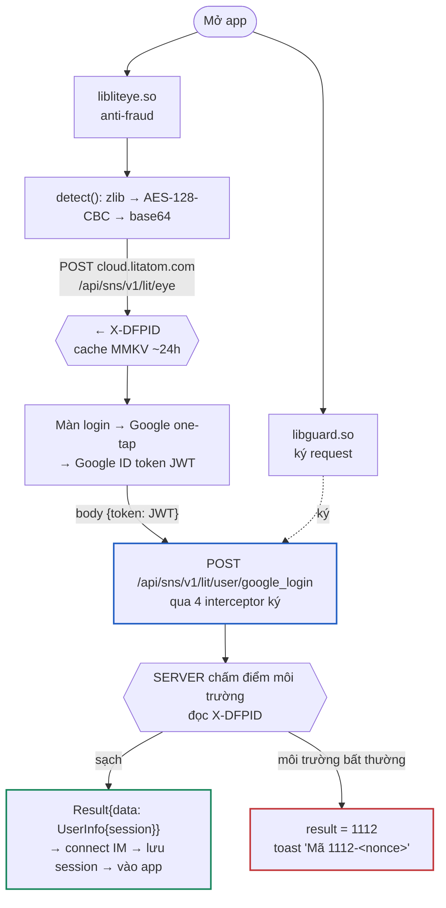
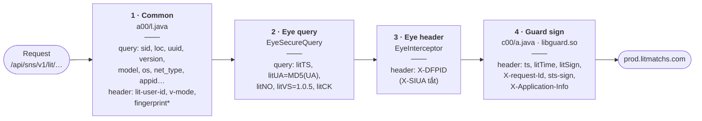

# Workflow — Tổng quan login + ký/gửi request

> Nguồn: `docs/09`, `docs/11`, interceptor `c00/a.java` · `a00/l.java` · `EyeSecureQuery.java`.

## 1. Luồng login tổng quan

## 2. Chuỗi 4 interceptor ký mỗi request

`*fingerprint` chỉ thêm cho endpoint auth (`get_sms_code`, `*_login`, `user/info`).

## 3. Bốn chữ ký — thuật toán

| Header | Công thức | Khóa / ghi chú |
|---|---|---|
| `litSign` | `base64("1\|" + md5(litTime + "1" + "R@s9!bu8"))` | salt `R@s9!bu8`; luôn mở đầu `MXw` |
| `sts-sign` | `base64(hex(HMAC-SHA256(key, ts+"_"+uuid)))` | key = `I am your father` (16B) |
| `X-Application-Info` | `base64url(AES-256-CBC(query_string) ‖ IV)` | mode 3, key `f1c9…3cd4`, IV random nối đuôi |
| `fingerprint` | `AES-256-CBC({"uuid":…})`, IV `abcdef1234567890` | mode 1, key `CB7F…5C0F`; chỉ endpoint auth |
| `X-DFPID` | server cấp qua `POST /api/sns/v1/lit/eye` | device fingerprint 198 trường, ~24h |

**1112** = verdict của **server** (không phải client chặn — đã xác nhận: không có gate client). Server đọc `X-DFPID` rồi chấm "bất thường", **nhưng không trả lý do cụ thể**. Giả thuyết hàng đầu (H1): tín hiệu user phụ không giấu được (`dual_app=1`, `uid=1010318`, `installed_from_google=0`). Confound chưa loại (H2): thiết bị đã bị blacklist từ ban user 0. Chi tiết + cách phân biệt: [../data/README.md](../data/README.md) §6.
