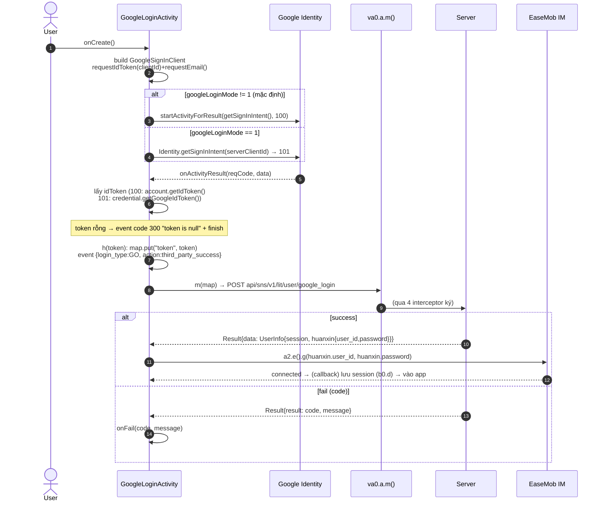

# Workflow — Google login (logic chi tiết)

> Response quan sát ngày 13/11 có `result=-1` khi báo môi trường bất thường,
> trong đó `1113-...` nằm trong message; không có bằng chứng mã trong message
> là giá trị `result`. Xem [hai lượt thực tế](../13-google-login-hai-truong-hop.md).

> Nguồn code: `com/lit/app/ui/login/GoogleLoginActivity.java` (flow cũ), `com/lit/app/ui/login/i0.java` = `GoogleLoginManager` (flow mới, androidx CredentialManager), iface `va0/a.java:76` (`m()`).

## 0. Tóm tắt

Google login **chỉ lấy ID token (JWT) từ Google rồi đưa cho server Litmatch** — app không tự xác thực gì. Server nhận `{"token": JWT}`, tự verify JWT với Google (qua clientId), rồi cấp `session`. Client chỉ lo: (a) lấy JWT, (b) gói vào map, (c) xử lý kết quả trả về.

Có **2 đường lấy JWT**, cùng gọi 1 endpoint:

| Flow | Class | Cơ chế Google |
|---|---|---|
| Cũ | `GoogleLoginActivity` | `GoogleSignIn` (reqCode 100) **hoặc** `Identity` one-tap (reqCode 101) |
| Mới | `i0.java` (`GoogleLoginManager`) | androidx **CredentialManager** (`b9.q` / `GetCredentialRequest`) |

ClientId (serverClientId) chung: `272687572250-i5659eubkl38ck9n17mrijl0neh7rgkc.apps.googleusercontent.com`

## 1. Sequence (flow `GoogleLoginActivity`)



## 2. Các bước code (GoogleLoginActivity)

1. **`onCreate`** — tạo `GoogleSignInClient` từ `GoogleSignInOptions.DEFAULT_SIGN_IN` + `.requestIdToken(clientId)` + `.requestEmail()`. Chọn flow qua cờ remote `ak.c.b("googleLoginMode", 0)`:
   - `!= 1` (mặc định `0`): `startActivityForResult(client.getSignInIntent(), 100)`.
   - `== 1`: `Identity.getSignInClient().getSignInIntent(GetSignInIntentRequest.setServerClientId(clientId))` → reqCode `101`.
2. **`onActivityResult(reqCode, resultCode, data)`**:
   - **100**: `GoogleSignIn.getSignedInAccountFromIntent(data).getResult()` → `account.getIdToken()`.
     - token rỗng → `i(300, "token is null")` + toast + `finish()`.
     - `ApiException` → `i(statusCode, msg)`; `12501` = user hủy (im lặng).
   - **101**: `resultCode != -1` → toast "Login Cancel[0]" + event cancel + finish. Ngược lại `Identity...getSignInCredentialFromIntent(data).getGoogleIdToken()`.
   - Cả hai nhánh thành công → gọi **`h(token)`**.
3. **`h(String token)`**:
   - Bắn analytics `login_event {login_type:"GO", action:"third_party_success"}`.
   - Hiện loading dialog (`rj.f.k(...)`).
   - `map.put("token", token)` → `((va0.a) a00.e.b(va0.a.class)).m(map).H(callback)`.
   - Request đi qua chuỗi interceptor (xem [01-tong-quan](01-tong-quan.md) §2): thêm query common + `litTS/litUA/...`, header `X-DFPID`, `litSign`, `sts-sign`, `X-Application-Info`, và vì là endpoint auth nên có cả `fingerprint`.
4. **`onSuccess(Result<UserInfo>)`**:
   - `data == null` hoặc `user_id` rỗng → `onFail(-1, "data_error")`.
   - Ngược lại → **connect EaseMob IM trước**: `a2.e().g(huanxin.user_id, huanxin.password, callback)` → trong callback mới lưu session (`b0.d`) + điều hướng vào app.

## 3. Bảng xử lý `onFail(code, msg)`

| Code | Xử lý |
|---|---|
| `-210` | Multi-account / cần xác thực → dialog `h1.a.Q(this, getOriginResponseText(), …)` (dùng lại **raw body** nhờ annotation `@c`) → thử lại với cùng token |
| `-200` | Tài khoản deactivate → post event `fy.v0()` (luồng reactivate) + `finish()` |
| `-14`, `-195`, `-101` | Im lặng (không toast) — xử lý ở nơi khác |
| **mọi code khác** | `ll.m.F(ctx, msg, …)` → thông báo message + `finish()` |
| (luôn luôn) | analytics `login_event {login_type:"GO", code, msg, action:"login_fail"}` |

Không thể suy ra `result=1112` chỉ từ chuỗi `1112-...` trong message. Lượt
đối chứng mới trả `result=-1` và message chứa `1113-...`.

## 4. Payload & endpoint

```
POST api/sns/v1/lit/user/google_login        (@o POST, @c giữ raw body, va0/a.java:76)
Body: {"token": "<Google ID token = JWT>"}    (@is0.a Map<String,String>)
Response: Result<UserInfo>
  UserInfo{ session, user_id, is_first_login, is_banned, huanxin{user_id,password}, … }
```

Facebook/TikTok y hệt khuôn này, chỉ khác field nguồn token và endpoint:
`va0.a.q` → `facebook_login` (FB access token) · `va0.a.a` → `tiktok_login` (OAuth authCode). Tất cả đều field `"token"`.
