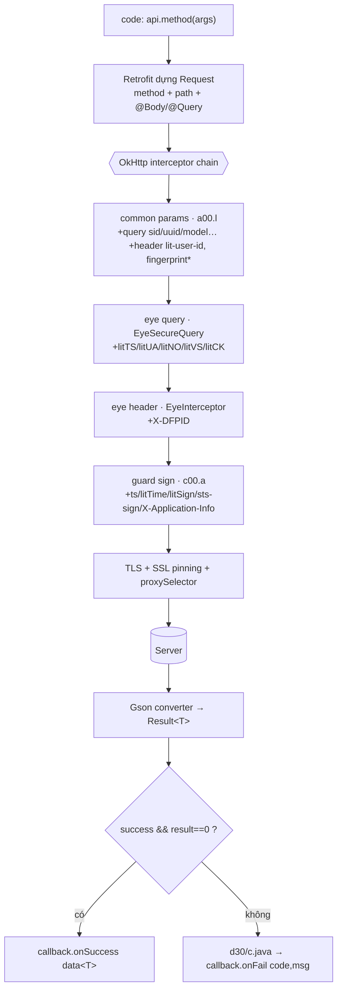

# Workflow — Cách gọi API (Retrofit/OkHttp)

> Cập nhật 13/11/2026: Xem [tài liệu 14](../14-api-khoi-dong-va-script.md)
> để đối chiếu request và response thực tế sau đăng nhập. Cấu hình được đặt tên
> `REQ_BODY_ENCRYPT` trong factory không đủ chứng minh mọi body luôn plaintext.

> App dùng **Retrofit + OkHttp**. ~**697 endpoint** `api/sns/v1/lit/...` rải trên **80 interface**. Doc này mô tả **cách gọi** (kiến trúc + vòng đời 1 request + danh mục), không liệt kê hết endpoint. Ký request xem [01-tong-quan](01-tong-quan.md)/[../06](../06-api-va-ky-request.md); sau-login xem [../11](../11-goi-api-sau-login.md).

## 1. Lấy service & gọi — khuôn chung

```java
// 1. Lấy proxy của interface (cache theo Class trong a00.e.f239b)
va0.a api = (va0.a) a00.e.b(va0.a.class);
// 2. Gọi method → trả về fs0.d<Result<T>> (Retrofit Call)
api.m(map).H(callback);     // .H(..) = enqueue(callback)  ·  hoặc .execute() đồng bộ
```
- `a00.e.b(Class)` = factory, **cache** service theo class (`HashMap f239b`).
- `a00.e.a()` dựng **Retrofit** 1 lần: `BASE_URL = https://www.litatom.com/` (`ns/y1.java:49`), converter **Gson**, cờ `enableRetrofitRetry`, `enableGsonSerializeNulls`, **SSL pinning** (`sp_key_ssl_pinning_switch`), `proxySelector` tùy biến (chống proxy), **`REQ_BODY_ENCRYPT = FALSE`** → **body gửi plaintext JSON** (chỉ query bị ký vào `X-Application-Info`).

## 2. Annotation Retrofit (obfuscate → ý nghĩa)

| Obfuscated | Retrofit | Obfuscated | Retrofit |
|---|---|---|---|
| `is0.f` | `@GET` | `is0.a` | `@Body` |
| `is0.o` | `@POST` | `is0.t` | `@Query` |
| `is0.p` | `@PUT` | `is0.s` | `@Path` |
| `is0.h` | `@HTTP` (DELETE có body) | `is0.l`/`is0.q` | `@Multipart`/`@Part` |
| `@com.litmatch.network.c` | **giữ raw body** (parse lại khi fail) | | |

## 3. Vòng đời một request


`*fingerprint` chỉ cho endpoint auth. Interceptor đăng ký ở `androidx/work/z.java` (`builder.a(new c00.a(..))`), `a00/i.java` (`new EyeInterceptor()`), bó hook common+eye-query gom trong `a00.n` (`com/lit/app/sea/engine/k.java:476`).

## 4. Host / routing

| Host | Dùng cho |
|---|---|
| `https://www.litatom.com/` | **BASE_URL** mặc định (`api/sns/v1/lit/...`) |
| `https://prod.litmatchs.com` | route `/api/ms` (TransferDomain) |
| `https://baishan.litatom.com/` | upload media (`image/simage/audio/video/oss/zip`) |
| `https://cloud.litatom.com` | liteye `/api/sns/v1/lit/eye` |
| `https://openim.litatom.com/api` · `wss://.../msg_gateway` | chat REST + websocket |
| `ksztagent.com` / `ksztin.com` | biến thể khu vực (PH…) |

> Host thực của một endpoint có thể bị **đổi runtime** qua TransferDomain (`/api/ms`), nên cùng path có thể đi `www.litatom.com` hoặc `prod.litmatchs.com` tùy cấu hình.

## 5. URL endpoint — PLAINTEXT (không mã hoá)

Path endpoint nằm **plaintext** trong annotation Retrofit (`@f("api/sns/v1/lit/...")`), **grep tĩnh ra hết 713 endpoint** (xem [04-danh-muc-api.md](04-danh-muc-api.md) + `../data/endpoints.txt`). *(Đính chính: ghi chú cũ "endpoint mã hoá, giải runtime qua `b0.p`" là **sai** — `b0.p` chỉ là hàm nối chuỗi.)*

## 6. Danh mục theo nhóm (interface tiêu biểu)

| Nhóm | Interface | Endpoint ví dụ |
|---|---|---|
| Login / user | `va0/a.java` | `user/{google,facebook,tiktok,phone,email}_login`, `get_sms_code`, `user/info`, `user/get_info/{id}`, `user/logout` |
| Account / pay | `z50/a.java`, `q00/c.java` | `account/account_info`, `account/products`, `account/buy_product`, `user/openim_login` |
| Chat / IM | (openim) | `openim.litatom.com/api/...` + websocket `msg_gateway` |
| Party / voice room | module `party/` | Agora RTC/RTM join, room ops (phần lớn endpoint mã hoá) |
| Match / feed / gift… | nhiều interface | hầu hết path mã hoá (xem §5) |

> Danh mục đầy đủ: `grep -rl 'import is0' base-decompiled/sources` (80 interface). Host/khoá/native ở [../99-phu-luc-endpoints.md](../99-phu-luc-endpoints.md).

## 7. Response & lỗi

Envelope `com/lit/app/net/Result<T>` (= `com.litmatch.network.Result`):
```json
{ "success": true, "result": 0, "message": "", "data": {…}, "diamonds": 0, "changed": false, "activity": "", "hash_code": "", "other_info": "" }
```
- `result==0 && success` → `onSuccess(data<T>)`. Ngược lại → `d30/c.java` ném `com.litmatch.network.a(result,message)` → `onFail(result, message)`.
- 5 endpoint login có `@c` → giữ **raw body** để parse lại khi fail (vd `-210` đọc lại response).
- Vài response có **body mã hoá** → giải bằng `decodeShadowContent(x, mode)` (xem [../07](../07-libguard-getsigncode.md) §4.2).
- Mã lỗi hay gặp: `-210` (multi-account/reauth), `-200` (deactivate), `-14/-195/-101` (im lặng), `1112` (môi trường bất thường — [01-tong-quan](01-tong-quan.md)).
